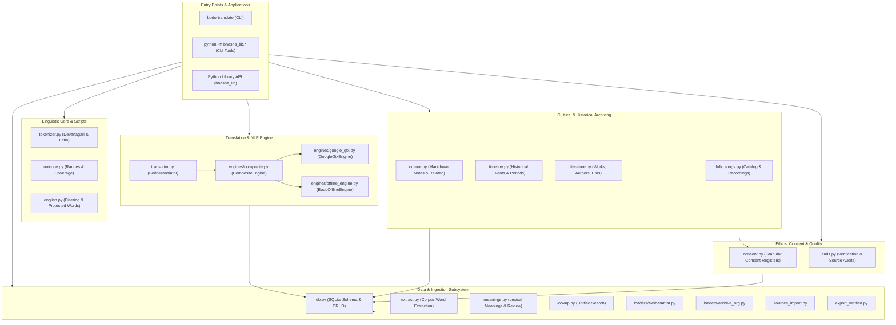
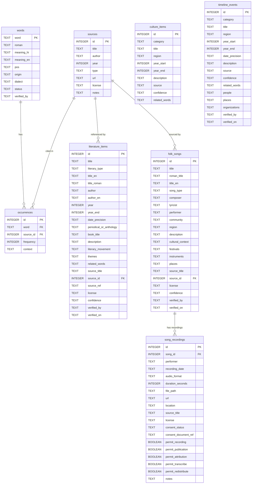

# bhasha_lib: Library Overview & Developer Guide

> [!IMPORTANT]
> **💡 File Insight & Purpose**:
> - **Role in Library**: System architecture blueprint, module catalog & developer API documentation.
> - **What is happening here**: Details the codebase structure, 23+ Python source files, translation engine hierarchy (Google GTX + Offline fallback), database schema diagrams (8 tables), CLI utilities, and developer testing patterns.
> - **Who should use it**: Developers, software engineers, and system contributors building NLP applications or extending the library.

> [!TIP]
> Looking for an inventory of actual data, datasets, cultural notes, and vocabulary stored in the library? See **[DATA_OVERVIEW.md](DATA_OVERVIEW.md)** and **[INVENTORY.md](INVENTORY.md)**.

---

## Table of Contents

1. [Executive Summary & Purpose](#1-executive-summary--purpose)
2. [High-Level Architecture](#2-high-level-architecture)
3. [Module & Subsystem Catalog](#3-module--subsystem-catalog)
   - [3.1 Translation & NLP Subsystem](#31-translation--nlp-subsystem)
   - [3.2 Linguistic Core & Script Processing](#32-linguistic-core--script-processing)
   - [3.3 Database & Storage Layer](#33-database--storage-layer)
   - [3.4 Cultural & Historical Heritage](#34-cultural--historical-heritage)
   - [3.5 Literature Cataloging Subsystem](#35-literature-cataloging-subsystem)
   - [3.6 Folk Songs & Audio Governance](#36-folk-songs--audio-governance)
   - [3.7 Lexical Meanings & Annotation Pipeline](#37-lexical-meanings--annotation-pipeline)
   - [3.8 Ethical Consent & Compliance Subsystem](#38-ethical-consent--compliance-subsystem)
   - [3.9 Auditing & Quality Control Engine](#39-auditing--quality-control-engine)
   - [3.10 Ingestion Loaders & Extractors](#310-ingestion-loaders--extractors)
   - [3.11 Scaffolding, Configuration & Export](#311-scaffolding-configuration--export)
4. [Relational Database Schema & Data Models](#4-relational-database-schema--data-models)
5. [Command-Line Tools (CLI) Reference](#5-command-line-tools-cli-reference)
6. [Python Public API Quick Reference](#6-python-public-api-quick-reference)
7. [Ethical Protocol & Data Governance](#7-ethical-protocol--data-governance)
8. [Repository Directory Map](#8-repository-directory-map)
9. [Developer Workflows & Testing](#9-developer-workflows--testing)

---

## 1. Executive Summary & Purpose

`bhasha_lib` is created to bridge the computational and archival divide for indigenous and regional languages of India, with initial deep support for **Bodo (`brx`)**, spoken across Assam and Northeast India.

The library solves several key domain challenges:
- **Bi-Script Support**: Handles both modern standard **Devanagari** (`बर'` / `बोडो`) and historical / archival **Latin/Roman** orthographies.
- **Hybrid Translation**: Pairs online neural translation (Google Translate GTX engine) with a deterministic, local **offline rule-based and morphological engine** backed by SQLite lexicons.
- **Structured Cultural & Historical Archiving**: Maintains source-backed, confidence-rated timelines, cultural practices, and literary works (poems, short stories, novels, plays, essays).
- **Ethical Consent & Oral Heritage Protection**: Enforces granular 5-tier consent tracking, documentation checks, and swift withdrawal/removal mechanisms for folk songs and community audio recordings.
- **Corpus Ingestion & Annotation Workflows**: Standardizes the ingestion of public datasets (e.g. AI4Bharat Aksharantar), historical books (Archive.org), and community CSV review cycles.

---

## 2. High-Level Architecture

The library is designed in layered modular tiers with loose coupling and lazy loading to guarantee fast startup times:



---

## 3. Module & Subsystem Catalog

All core source code lives inside [`src/bhasha_lib/`](file:///f:/bodo/src/bhasha_lib/). Below is the complete catalog of files, their purposes, and primary APIs.

### Quick Module Summary Table

| Module File | Primary Purpose | Key Classes & Functions |
| :--- | :--- | :--- |
| [`__init__.py`](file:///f:/bodo/src/bhasha_lib/__init__.py) | Package initialization, lazy export loader, and version metadata | `__version__`, lazy `__getattr__`, `__all__` |
| [`__main__.py`](file:///f:/bodo/src/bhasha_lib/__main__.py) | Top-level execution handler for `python -m bhasha_lib` | CLI forwarding to `bhasha_lib.cli` |
| [`cli.py`](file:///f:/bodo/src/bhasha_lib/cli.py) | Console entrypoint for `bodo-translate` CLI command | `main()`, argument parsing, engine selection |
| [`translator.py`](file:///f:/bodo/src/bhasha_lib/translator.py) | High-level translation interface & caching manager | `BodoTranslator`, `translate()`, `translate_batch()`, `detect()` |
| [`engines/base.py`](file:///f:/bodo/src/bhasha_lib/engines/base.py) | Abstract base class and dataclasses for translation engines | `TranslationEngine`, `TranslationResult` |
| [`engines/composite.py`](file:///f:/bodo/src/bhasha_lib/engines/composite.py) | Multi-engine router with online-to-offline fallback & caching | `CompositeEngine` |
| [`engines/google_gtx.py`](file:///f:/bodo/src/bhasha_lib/engines/google_gtx.py) | HTTP client for Google Translate GTX endpoint with Bodo support | `GoogleGtxEngine` |
| [`engines/offline_engine.py`](file:///f:/bodo/src/bhasha_lib/engines/offline_engine.py) | Offline SQLite lexicon lookup with Bodo morphological rules | `BodoOfflineEngine` |
| [`tokenizer.py`](file:///f:/bodo/src/bhasha_lib/tokenizer.py) | Script-aware tokenizers for Devanagari and Latin text | `tokenize()`, `tokenize_roman()`, `normalize()` |
| [`unicode.py`](file:///f:/bodo/src/bhasha_lib/unicode.py) | Unicode character validation and script coverage | `is_devanagari()`, `filter_devanagari()`, `calculate_coverage()` |
| [`english.py`](file:///f:/bodo/src/bhasha_lib/english.py) | English word detection and Bodo homograph protection | `is_english_word()`, `is_english_inflection()`, `BODO_PROTECTED_WORDS` |
| [`db.py`](file:///f:/bodo/src/bhasha_lib/db.py) | SQLite database schema, CRUD operations, and transaction helpers | `init_db()`, `get_connection()`, `backup_db()`, `add_*()` |
| [`sources_import.py`](file:///f:/bodo/src/bhasha_lib/sources_import.py) | Ingests bibliography source records from CSV with license checks | `import_sources_csv()` |
| [`culture.py`](file:///f:/bodo/src/bhasha_lib/culture.py) | Cultural markdown parser and semantic entity relations | `load_culture_dir()`, `related()`, `reset_confidence()` |
| [`timeline.py`](file:///f:/bodo/src/bhasha_lib/timeline.py) | Chronological historical event cataloging and filtering | `add_historical_event()`, `get_timeline()`, `search_events()` |
| [`literature.py`](file:///f:/bodo/src/bhasha_lib/literature.py) | Bodo literary works management, search, and CSV/JSON interchange | `add_literary_record()`, `search_literature()`, `export_literature_csv()` |
| [`folk_songs.py`](file:///f:/bodo/src/bhasha_lib/folk_songs.py) | Folk song registry, audio recording metadata, and consent links | `add_folk_song()`, `add_song_recording()`, `withdraw_recording_consent()` |
| [`consent.py`](file:///f:/bodo/src/bhasha_lib/consent.py) | Ethical consent validation, permission scopes, and verification | `ConsentRecord`, `ConsentStatus`, `validate_consent_dict()` |
| [`meanings.py`](file:///f:/bodo/src/bhasha_lib/meanings.py) | Meaning annotation pipeline, bootstrap seed, and review export/import | `bootstrap_seed_meanings()`, `export_for_review()`, `import_meanings()` |
| [`lookup.py`](file:///f:/bodo/src/bhasha_lib/lookup.py) | Unified cross-table lookup for words, contexts, and culture items | `lookup_term()` |
| [`audit.py`](file:///f:/bodo/src/bhasha_lib/audit.py) | Comprehensive quality audit for sources, claims, citations & consent | `audit_culture_and_history()`, `is_vague_source()` |
| [`extract.py`](file:///f:/bodo/src/bhasha_lib/extract.py) | Text extraction pipeline from raw texts into word occurrences | `extract_file()`, `strip_gutenberg()` |
| [`loaders/aksharantar.py`](file:///f:/bodo/src/bhasha_lib/loaders/aksharantar.py) | AI4Bharat Aksharantar dataset zip archive loader | `load_aksharantar()` |
| [`loaders/archive_org.py`](file:///f:/bodo/src/bhasha_lib/loaders/archive_org.py) | Downloader and parser for historical books on Archive.org | `load_historical_book()`, `AVAILABLE_BOOKS` |
| [`newnote.py`](file:///f:/bodo/src/bhasha_lib/newnote.py) | Generator for valid cultural note markdown templates | `create_new_note()` |
| [`export_verified.py`](file:///f:/bodo/src/bhasha_lib/export_verified.py) | Clean exporter for verified lexicon datasets (CSV/JSON/License) | `export_verified()` |
| [`config.py`](file:///f:/bodo/src/bhasha_lib/config.py) | YAML language configuration loader | `LanguageConfig`, `load_config()`, `get_bodo_config()` |
| [`archive.py`](file:///f:/bodo/src/bhasha_lib/archive.py) | Resolves standardized directory paths in `data/archive/<lang>/` | `get_archive_path()`, `verify_archive_structure()` |

---

### 3.1 Translation & NLP Subsystem

The translation subsystem enables bidirectional translation between Bodo (`brx`), English (`en`), Hindi (`hi`), and other Indian languages.

- [`translator.py`](file:///f:/bodo/src/bhasha_lib/translator.py):
  Provides the primary client API:
  - `translate(text, source='auto', target='brx', offline=False, engine=None, db_path=None)`: Main entry point.
  - `translate_batch(texts, ...)`: Efficient batch translations.
  - `detect(text)`: Identifies language codes (returns `'brx'` when Devanagari Bodo patterns are matched).
  - `BodoTranslator`: Stateful translation class managing memory cache and engine lifecycle.
- [`engines/base.py`](file:///f:/bodo/src/bhasha_lib/engines/base.py):
  Defines `TranslationEngine` (abstract base class) and the `TranslationResult` dataclass containing:
  - `text`, `source_lang`, `target_lang`, `engine_name`, `confidence`, `cached`, `offline`, and `metadata`.
- [`engines/google_gtx.py`](file:///f:/bodo/src/bhasha_lib/engines/google_gtx.py):
  Online translation engine querying the Google Translate GTX endpoint with randomized user agents, exponential backoffs, and language mapping.
- [`engines/offline_engine.py`](file:///f:/bodo/src/bhasha_lib/engines/offline_engine.py):
  Self-contained offline translation engine. Performs:
  1. Lexicon exact matching from the SQLite database.
  2. Bodo morphological analysis: detaches case markers (genitive `-नि`, accusative `-खौ`, dative `-नो`, locative `-आव`), plural markers (`-फोर`), and postpositions.
  3. Reverse English/Hindi to Bodo mapping using definition indexing.
- [`engines/composite.py`](file:///f:/bodo/src/bhasha_lib/engines/composite.py):
  Chains engines together: queries online first; upon network failure, timeout, or explicit `--offline` request, transparently falls back to `BodoOfflineEngine`.

---

### 3.2 Linguistic Core & Script Processing

- [`tokenizer.py`](file:///f:/bodo/src/bhasha_lib/tokenizer.py):
  - `tokenize(text)`: Extracts Devanagari tokens while discarding non-Devanagari symbols and punctuation.
  - `tokenize_roman(text)`: Tokenizes Latin-script text (historical Bodo books), lowercasing and cleaning delimiters.
  - `normalize(text)`: Normalizes all strings to Unicode NFC format.
- [`unicode.py`](file:///f:/bodo/src/bhasha_lib/unicode.py):
  - Validates character boundaries in Unicode Devanagari (`U+0900` to `U+097F`).
  - `calculate_coverage(text)`: Measures what percentage of characters belongs to the target script.
  - `filter_devanagari(text)`: Strips non-Devanagari characters.
- [`english.py`](file:///f:/bodo/src/bhasha_lib/english.py):
  - Distinguishes authentic Bodo words from English loanwords or bilingual book noise.
  - Contains `BODO_PROTECTED_WORDS`: Protects authentic Bodo words that resemble English words or abbreviations (e.g., `मा` [what], `था` [stay], `नो` [house], `हा` [land], `आं` [I], `बि` [he/she], `बे` [this], `सो` [insert]).
  - Evaluates common English suffixes (`-ing`, `-ed`, `-tion`, `-ment`) with `is_english_inflection()`.

---

### 3.3 Database & Storage Layer

- [`db.py`](file:///f:/bodo/src/bhasha_lib/db.py):
  The persistence backbone using Python's built-in `sqlite3`.
  - Thread-safe transaction helper: `get_connection(db_path, timeout=...)` with write-ahead logging (WAL) support.
  - Database initializer: `init_db(db_path)` sets up tables, indexes, and constraints.
  - Automated database backup: `backup_db(db_path, backup_dir=None)` creates a timestamped copy before hazardous bulk operations.
  - Insertion helpers with validation: `add_source()`, `add_word()`, `add_occurrence()`, `add_culture_item()`, `add_timeline_event()`, `add_literature_item()`, `add_folk_song_item()`, `add_song_recording_item()`.
- [`sources_import.py`](file:///f:/bodo/src/bhasha_lib/sources_import.py):
  Loads bibliography references from CSV files into the `sources` table. Enforces that every source includes a mandatory, non-empty `license`.

---

### 3.4 Cultural & Historical Heritage

- [`culture.py`](file:///f:/bodo/src/bhasha_lib/culture.py):
  - Parses cultural markdown documents (`.md` files in `data/archive/bodo/culture/`) with YAML frontmatter.
  - Validates categories (`dance`, `festival`, `attire`, `belief`, `ritual`, `instrument`, `custom`, etc.).
  - `related(term, db_path)`: High-level query searching cultural metadata and occurrences matching a term.
  - `reset_confidence(db_path)`: Reverts unverified records to `needs_check`.
- [`timeline.py`](file:///f:/bodo/src/bhasha_lib/timeline.py):
  - Manages chronological history milestones, social movements, accords, and literary foundations.
  - Supported date precisions: `exact`, `decade`, `approximate`, `century`, `unknown`.
  - Filters and searches by year span, category, entities, places, or keywords.
  - Citation auditing: flags timeline items lacking sources via `get_events_missing_citations()`.

---

### 3.5 Literature Cataloging Subsystem

- [`literature.py`](file:///f:/bodo/src/bhasha_lib/literature.py):
  Dedicated registry for Bodo literary heritage across historical and modern eras.
  - Supported genres: `poem`, `short_story`, `novel`, `play`, `folk_tale`, `essay`, `collection`, `other`.
  - Tracks authors, publication year, historical periodicals (*Bibar*, *Alari*, *Nayek*), literary movements (e.g. Bibar Era), and themes.
  - Verification lifecycle: `unverified` -> `needs_check` -> `verified` (with `verified_by` reviewer and `verified_on` date).
  - Data interchange: full support for CSV and JSON import/export, featuring `--dry-run` validation and automatic database backups.

---

### 3.6 Folk Songs & Audio Governance

- [`folk_songs.py`](file:///f:/bodo/src/bhasha_lib/folk_songs.py):
  Comprehensive archive for traditional songs, chants, and accompanying audio recordings.
  - Supported song types: `traditional_folk_song`, `work_song`, `festival_song`, `lullaby`, `devotional_song`, `dance_song`, `ritual_song`, `ballad`, `other`.
  - Links songs with traditional instruments (e.g. *Kham*, *Siphung*, *Serja*, *Jotha*, *Tharkha*) and seasonal festivals (e.g. *Bwisagu*).
  - Audio recording management: catalogs performer metadata, audio formats (`mp3`, `wav`, `flac`, `ogg`, `aac`), duration, and storage references.
  - Direct integration with ethical consent controls: prevents publishing unconsented audio and provides instant withdrawal (`withdraw_recording_consent()`) or community removal (`request_recording_removal()`).

---

### 3.7 Lexical Meanings & Annotation Pipeline

- [`meanings.py`](file:///f:/bodo/src/bhasha_lib/meanings.py):
  Orchestrates community and expert annotation of dictionary definitions.
  - `bootstrap_seed_meanings()`: Seeds high-frequency Bodo vocabulary with verified English and Hindi meanings.
  - `export_for_review()`: Exports unannotated high-frequency words into structured CSV review files.
  - `import_reviewed_csv()`: Validates and imports reviewed CSV files back into the database.
  - `get_meanings_stats()`: Reports total vocabulary, annotated count, and verification progress.
- [`lookup.py`](file:///f:/bodo/src/bhasha_lib/lookup.py):
  Unified search module that takes any term, executes exact and prefix matches on words, retrieves sentence occurrences with bibliographic citations, and aggregates related cultural notes.

---

### 3.8 Ethical Consent & Compliance Subsystem

- [`consent.py`](file:///f:/bodo/src/bhasha_lib/consent.py) & [`CONSENT_AND_ETHICS.md`](file:///f:/bodo/CONSENT_AND_ETHICS.md):
  Provides programmatic enforcement of indigenous data sovereignty and ethical archiving.
  - `ConsentStatus`: Enum representing `UNKNOWN`, `PENDING`, `GRANTED`, `DENIED`, and `WITHDRAWN`.
  - `ConsentRecord`: Dataclass governing 5 granular permission dimensions:
    1. `permit_recording`
    2. `permit_publication`
    3. `permit_attribution`
    4. `permit_transcribe`
    5. `permit_redistribute`
  - Document verification: Verifies that physical or digital consent documents exist on disk before `granted` status is accepted.

---

### 3.9 Auditing & Quality Control Engine

- [`audit.py`](file:///f:/bodo/src/bhasha_lib/audit.py):
  Automated linter and quality auditor for linguistic, cultural, and historical entries.
  - **Vague Source Detection**: Rejects generic citations consisting solely of domain names (e.g., "wikipedia.org", "google.com") without specific titles, volumes, or gazettes.
  - **Copyright & Lyrics Safeguard**: Flags text blocks resembling verbatim song lyrics or copyrighted literary content.
  - **Unverified & Missing Citation Auditing**: Generates actionable summaries of records requiring verification.

---

### 3.10 Ingestion Loaders & Extractors

- [`extract.py`](file:///f:/bodo/src/bhasha_lib/extract.py):
  Extracts words and counts frequencies from raw text files into SQLite `words` and `occurrences` tables.
- [`loaders/aksharantar.py`](file:///f:/bodo/src/bhasha_lib/loaders/aksharantar.py):
  Streams and extracts transliteration word pairs from AI4Bharat Aksharantar zip archives directly into SQLite.
- [`loaders/archive_org.py`](file:///f:/bodo/src/bhasha_lib/loaders/archive_org.py):
  Downloads and ingests historical 19th and early 20th-century books on Bodo from the Internet Archive (e.g., J.D. Anderson 1895, Sidney Endle 1884).

---

### 3.11 Scaffolding, Configuration & Export

- [`config.py`](file:///f:/bodo/src/bhasha_lib/config.py):
  Parses `bodo.yaml` language definitions (scripts, character boundaries, test words, metadata).
- [`archive.py`](file:///f:/bodo/src/bhasha_lib/archive.py):
  Guarantees standardized directory layout across `data/archive/<language>/` (`culture`, `folk_songs`, `history`, `books`, `datasets`).
- [`newnote.py`](file:///f:/bodo/src/bhasha_lib/newnote.py):
  Scaffolds compliant Markdown files with valid YAML frontmatter and `needs_check` confidence status.
- [`export_verified.py`](file:///f:/bodo/src/bhasha_lib/export_verified.py):
  Generates clean public release packages (`lexicon_verified.csv` with BOM, `lexicon_verified.json`, `DATA_LICENSE.txt`) containing only community/expert-verified words.

---

## 4. Relational Database Schema & Data Models

The library utilizes a standardized SQLite schema (`data/lexicon.sqlite`) structured into 8 relational tables:



### Enumerations & Constraint Values

- **`VALID_STATUSES` (Lexicon)**: `'unverified'`, `'community'`, `'expert'`
- **`VALID_ORIGINS`**: `'indigenous'`, `'sanskrit_loan'`, `'english_loan'`, `'assamese_loan'`, `'bengali_loan'`, `'unknown'`
- **`VALID_CONFIDENCE_LEVELS`**: `'unverified'`, `'needs_check'`, `'verified'`
- **`VALID_DATE_PRECISIONS`**: `'exact'`, `'decade'`, `'approximate'`, `'century'`, `'unknown'`
- **`VALID_LITERARY_TYPES`**: `'poem'`, `'short_story'`, `'novel'`, `'play'`, `'folk_tale'`, `'essay'`, `'collection'`, `'other'`
- **`VALID_SONG_TYPES`**: `'traditional_folk_song'`, `'work_song'`, `'festival_song'`, `'lullaby'`, `'devotional_song'`, `'dance_song'`, `'ritual_song'`, `'ballad'`, `'other'`
- **`VALID_AUDIO_FORMATS`**: `'mp3'`, `'wav'`, `'flac'`, `'ogg'`, `'aac'`
- **`VALID_CONSENT_STATES`**: `'unknown'`, `'pending'`, `'granted'`, `'denied'`, `'withdrawn'`

---

## 5. Command-Line Tools (CLI) Reference

The library provides command-line utilities for all common operational tasks.

### 5.1 Translation CLI (`bodo-translate`)
```bash
# Translate text to Bodo (Assam region)
bodo-translate "Welcome to Assam"

# Translate offline using local lexicon & morphology
bodo-translate "water" --offline

# Translate Bodo back to English
bodo-translate "दै" --target en

# Detect language code
bodo-translate "मानसिफोर गामआव दं" --detect

# Top-level python module execution
python -m bhasha_lib "Hello world"
```

### 5.2 Timeline & History CLI
```bash
# View complete chronological timeline
python -m bhasha_lib.timeline --db data/lexicon.sqlite

# Filter timeline by year range and category
python -m bhasha_lib.timeline --category history --from-year 1950 --to-year 2000

# Search historical events
python -m bhasha_lib.timeline --search "Basugaon" --verbose

# Audit unverified events or missing citations
python -m bhasha_lib.timeline --missing-citations
python -m bhasha_lib.timeline --unverified
```

### 5.3 Literature Management CLI
```bash
# Search literature by title or author
python -m bhasha_lib.literature --search "सतिश चन्द्र" --verbose

# Filter literature by type and era
python -m bhasha_lib.literature --type poem --from-year 1920 --to-year 1960

# Audit citations and unverified records
python -m bhasha_lib.literature --missing-citations
python -m bhasha_lib.literature --unverified

# Export and import literature records (with dry-run option)
python -m bhasha_lib.literature --export-csv literature.csv --type poem
python -m bhasha_lib.literature --export-json literature.json
python -m bhasha_lib.literature --import-csv new_works.csv --dry-run
python -m bhasha_lib.literature --import-csv new_works.csv
```

### 5.4 Folk Songs & Audio Recordings CLI
```bash
# Search and filter folk songs
python -m bhasha_lib.folk_songs search "Kham" --db data/lexicon.sqlite
python -m bhasha_lib.folk_songs filter --type festival_song --region Kokrajhar

# View recordings attached to song ID 1
python -m bhasha_lib.folk_songs recordings 1 --db data/lexicon.sqlite

# Audit missing citations, unverified songs, or recordings lacking consent
python -m bhasha_lib.folk_songs missing-citations --db data/lexicon.sqlite
python -m bhasha_lib.folk_songs unverified --db data/lexicon.sqlite
python -m bhasha_lib.folk_songs missing-consent --db data/lexicon.sqlite

# Withdraw consent or register cultural removal request
python -m bhasha_lib.folk_songs withdraw-consent 1 --reason "Performer requested withdrawal"
python -m bhasha_lib.folk_songs request-removal 1 --reason "Sacred ritual restriction"

# Export and import folk song metadata
python -m bhasha_lib.folk_songs export --csv songs.csv
python -m bhasha_lib.folk_songs import --csv new_songs.csv --dry-run
```

### 5.5 Lexicon Annotation & Community Review CLI
```bash
# Display lexicon annotation statistics
python -m bhasha_lib.meanings stats --db data/lexicon.sqlite

# Bootstrap high-frequency seed meanings
python -m bhasha_lib.meanings bootstrap --db data/lexicon.sqlite

# Export unannotated high-frequency words for community review
python -m bhasha_lib.meanings export review_batch.csv --min-freq 2 --limit 500

# Import completed community review CSV
python -m bhasha_lib.meanings import completed_meanings.csv --db data/lexicon.sqlite
```

### 5.6 Quality Auditing & Extraction CLI
```bash
# Run quality audit on cultural notes, citations, and consent files
python -m bhasha_lib.audit data/archive/bodo/culture

# Extract words from raw texts into lexicon
python -m bhasha_lib.extract text.txt --source-id 1 --license public_domain

# Unified term lookup across dictionary, occurrences, and culture notes
python -m bhasha_lib.lookup "Bagurumba" --db data/lexicon.sqlite

# Ingest historical books from Archive.org
python -m bhasha_lib.loaders.archive_org --book anderson_1895 --db data/lexicon.sqlite

# Scaffold a new cultural note template
python -m bhasha_lib.newnote --category dance --title "Bagurumba" --out data/archive/bodo/culture

# Export clean verified lexicon for public release
python -m bhasha_lib.export_verified --out dist_lexicon --db data/lexicon.sqlite
```

---

## 6. Python Public API Quick Reference

```python
import bhasha_lib as bl

# --- 1. Translation & Language Detection ---
# Online translation with automatic offline fallback
bodo_text = bl.translate("Welcome to Assam")
print(bodo_text)

# Force offline translation using local SQLite lexicon & morphological rules
print(bl.translate("water", offline=True))  # Output: दै

# Translate Bodo to English or Hindi
print(bl.translate("दै", target="en"))      # Output: water

# Detect Bodo language
print(bl.detect("मानसिफोर गामआव दं"))      # Output: brx

# --- 2. Database Initialization ---
bl.init_db("data/lexicon.sqlite")

# --- 3. Unified Term Lookup ---
result = bl.lookup_term("Bagurumba", db_path="data/lexicon.sqlite")
print(result["words"])           # Exact and prefix matches in lexicon
print(result["culture_items"])   # Cultural background and related items

# --- 4. Historical Timeline Queries ---
timeline = bl.get_timeline(from_year=1950, to_year=2000, db_path="data/lexicon.sqlite")
for event in timeline:
    print(f"[{event['year_start']}] {event['title']}")

# --- 5. Literature Cataloging ---
poem_id = bl.add_literary_record(
    title="हाबिला खावनाय",
    literary_type="short_story",
    author="सतिश चन्द्र बसुमतारी",
    year=1919,
    date_precision="exact",
    book_title="बिबार (Bibar Magazine)",
    source_title="Bodo Sahitya Sabha Archival Records",
    confidence="verified",
    verified_by="Archival Review Board",
    verified_on="2024-01-15",
    db_path="data/lexicon.sqlite",
)

# --- 6. Folk Song & Ethical Audio Registration ---
song_id = bl.add_folk_song(
    title="खाम सिफुं दामनानै",
    song_type="festival_song",
    festivals=["Bwisagu"],
    instruments=["Kham", "Siphung"],
    source_title="Folk Songs of the Bodos (1960)",
    license="CC-BY-NC-SA-4.0",
    db_path="data/lexicon.sqlite",
)

# Register audio recording with explicit verified consent document
rec_id = bl.add_song_recording(
    song_id=song_id,
    performer="Community Elders",
    audio_format="wav",
    duration_seconds=185,
    consent_status="granted",
    consent_document_ref="consents/2026_01.pdf",
    permit_attribution=True,
    permit_redistribute=True,
    db_path="data/lexicon.sqlite",
)

# --- 7. Consent Revocation Protocol ---
bl.withdraw_recording_consent(
    rec_id, 
    reason="Performer family requested withdrawal", 
    db_path="data/lexicon.sqlite"
)
```

---

## 7. Ethical Protocol & Data Governance

`bhasha_lib` adheres to strict data ethics, indigenous data governance, and copyright rules:

1. **Consent Before Distribution**:
   Audio recordings of oral traditions, folk songs, or sacred chants must have verified consent documentation on record before being made public. Unconfirmed historical recordings default to `unknown` and are not distributed.
2. **Granular Permissions**:
   Consent is not monolithic. Permissions for recording, publication, attribution, transcription, and redistribution are tracked independently.
3. **Right of Withdrawal & Cultural Removal**:
   Community custodians or performers can revoke consent at any time using `withdraw_recording_consent()`. For sacred or sensitive materials, `request_recording_removal()` marks items as restricted.
4. **Mandatory License Tracking**:
   No source record can be created without an explicit, non-empty `license` field.
5. **Anti-Hallucination & Provenance**:
   Automated agents and contributors must never fabricate historical dates, names, committee resolutions, or citations. Unsupported claims must be marked `needs_check`. Generic citations (e.g. "Wikipedia") are flagged by the audit engine.
6. **No Binary Audio in Source Git**:
   Large audio binaries (`.mp3`, `.wav`, `.flac`) and dataset zips are excluded via `.gitignore`. Repositories store structured metadata, references, and reproducible pipelines.

---

## 8. Repository Directory Map

```
bhasha-lib/
├── LICENSE                            # MIT License (covers software and code only)
├── AGENT_RULES.md                     # Operational constraints for AI agents & contributors
├── CONSENT_AND_ETHICS.md              # Ethical protocol, consent templates & sovereignty rules
├── DATA_OVERVIEW.md                   # Data catalog: vocabulary, culture, history & sources
├── INVENTORY.md                       # Item-by-item directory: books, foods, dances, instruments
├── LIBRARY_OVERVIEW.md                # This document (architecture & module catalog)
├── README.md                          # Quick start and general usage documentation
├── pyproject.toml                     # Packaging configuration, scripts, and dependencies
├── bodo.yaml                          # Bodo language specification (scripts, ranges, tests)
├── configs/
│   └── bodo.yaml                      # Secondary language config reference
├── data/
│   └── archive/
│       └── bodo/
│           ├── culture/               # Cultural markdown drafts (.md tracked in git)
│           ├── folk_songs/            # Folk song markdown drafts & audio (gitignored)
│           ├── history/               # Historical notes (.md tracked in git)
│           ├── books/                 # Raw texts & historical books (gitignored)
│           └── datasets/              # External dataset archives (gitignored)
├── examples/
│   └── folk_song_template.md          # Sample folk song template with consent schema
├── src/
│   └── bhasha_lib/                    # Core Python package (all modules detailed in Section 3)
│       ├── engines/                   # Translation engine implementations
│       ├── loaders/                   # External corpus & book loaders
│       ├── resources/
│       │   └── english_words.txt      # Curated English dictionary for noise filtering
│       └── py.typed                   # PEP 561 type annotation marker
└── tests/                             # Comprehensive pytest test suite (200+ unit tests)
```

---

## 9. Developer Workflows & Testing

### Installation for Development
```bash
# Clone the repository
git clone https://github.com/<YOUR-USERNAME>/bhasha-lib.git
cd bhasha-lib

# Install with development dependencies (pytest, ruff)
pip install -e ".[dev]"
```

### Running Tests
The library maintains a comprehensive test suite across all subsystems:
```bash
# Run the complete test suite
pytest

# Run tests with short progress output
pytest -q

# Run specific test modules
pytest tests/test_translation.py
pytest tests/test_literature.py
pytest tests/test_folk_songs.py
pytest tests/test_audit.py
```

### Code Formatting & Linting
The project uses `ruff` for linting and code formatting:
```bash
# Check for lint errors
ruff check .

# Automatically apply safe fixes
ruff check --fix .

# Verify code formatting
ruff format --check .
```

### Database Migration & Safety Rule
When performing bulk data imports, schema alterations, or review cycles, always generate a backup:
```python
from bhasha_lib.db import backup_db

# Create a timestamped backup before operations
backup_path = backup_db("data/lexicon.sqlite")
print(f"Backup created at: {backup_path}")
```
